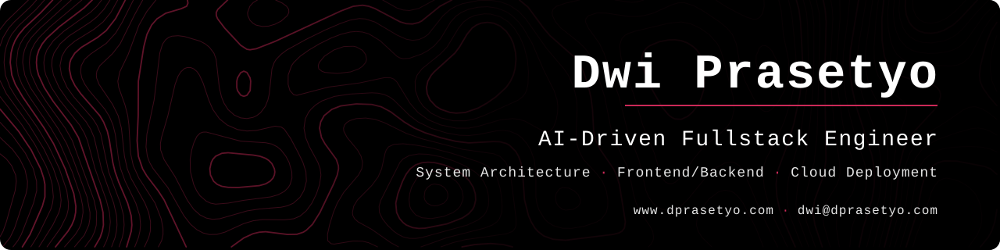
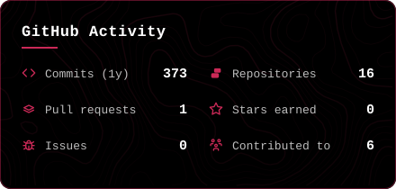
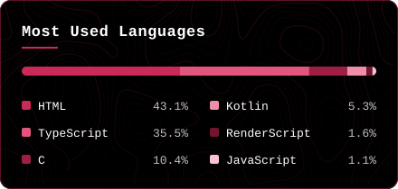
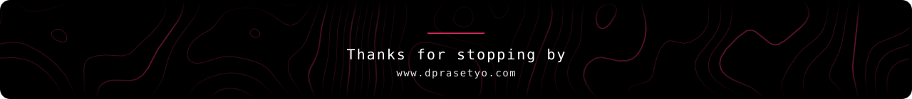

<!--
  PANDUAN EDIT CEPAT
  - Ganti "LINKEDIN_USERNAME" dengan username LinkedIn Anda.
  - Teks banner (nama, jabatan, website) diubah di file assets/banner.svg, bagian [EDIT-1].
  - Bagian lain diberi tanda [EDIT-x]. Cari tandanya, ubah isinya.
  - Ikon ada di folder assets/icons (dari itshover.com). Untuk mengganti ikon, ubah nama file di src=.
  - Kartu statistik dibuat otomatis oleh GitHub Actions; pengaturannya di scripts/generate-stats.mjs, bagian [EDIT-S].
-->

  

<!-- [EDIT-2] TEKS BERJALAN: ubah parameter lines= ; pisahkan tiap kalimat dengan ";" dan spasi ditulis "+" -->

  

<!-- [EDIT-3] TOMBOL KONTAK: ubah URL di href= -->

  
  
  

---

##  About Me

<!-- [EDIT-4] CERITA SINGKAT: tulis ulang paragraf ini dengan bebas -->
I'm **Dwi Prasetyo**, a fullstack engineer from Batam, Indonesia. I joined **HNS IT Center** in September 2024 as one of its first employees, starting as a website developer, and now lead its IT Development division.

My work covers the whole path of a product: system architecture, frontend, backend, and cloud deployment. I use AI heavily in my workflow to ship faster without lowering the bar on quality.

<!-- [EDIT-5] FAKTA SINGKAT: satu baris = satu fakta. Ganti ikon lewat nama file di src= -->

  &nbsp; Lead Software Engineer at <b>HNS IT Center</b> 
  &nbsp; Focused on internal business systems and e-commerce 
  &nbsp; Based in Batam, Indonesia 
  &nbsp; More about me at <a href="https://www.dprasetyo.com">dprasetyo.com</a>

---

##  Currently Learning

<!-- [EDIT-6] SEDANG DIPELAJARI: ubah kalimat pembuka dan baris-barisnya -->
Leading a team means owning more than the code, so I'm closing the gaps around it:

  &nbsp; <b>DevOps</b>: containers, CI/CD, and self-hosted deployment 
  &nbsp; <b>Manual QA</b>: test plans, test cases, and structured bug reporting 
  &nbsp; <b>Automated testing</b>: unit, integration, and end-to-end

---

##  What I'm Building

<!-- [EDIT-7] PROYEK: satu baris tabel = satu proyek. Format: | Nama | Deskripsi | -->
| Project | What it does |
| --- | --- |
| **HRIS** _(in progress)_ | Human resources information system for internal teams |
| **Auth (SSO)** | Single sign-on service for HNS IT Center; several internal websites already log in through it |
| **E-Commerce Platform** | Migrating a company storefront to Next.js |
| **Document Automation** | Generating procurement documents automatically |
| **Technician Ticketing** | Tracking service jobs for field technicians |
| **Stock App** | Inventory tool integrated with accounting software |
| **Task Manager** | Internal task and workload tracking |

---

##  Tech Stack

<!-- [EDIT-8] IKON TEKNOLOGI: ubah daftar setelah i= (pisahkan dengan koma).
     Daftar nama ikon yang tersedia: https://skillicons.dev -->
**Languages & frameworks**

  

**Cloud & infrastructure**

  

<!-- [EDIT-8b] KETERANGAN LAYANAN CLOUD: tambahkan layanan yang tidak punya ikon di sini -->
Dokploy on a self-hosted VPS for deployment, Cloudflare R2 for object storage

**Tools**

  

---

##  Languages

<!-- [EDIT-9] BAHASA: satu baris tabel = satu bahasa. Perbarui level saat sudah ada hasil tes resmi -->
| Language | Level |
| --- | --- |
| **Indonesian** | Native |
| **English** | Working proficiency (self-assessed, roughly IELTS 6.0 to 7.0; not yet formally tested) |
| **German** | Beginner (A1 to A2), still learning |

---

##  Beyond Code

<!-- [EDIT-10] HOBI: ubah kalimat ini dengan bebas -->
Away from the keyboard I run, ride my bike, listen to music, sing, and play games.

---

##  Where I'm Heading

<!-- [EDIT-11] TUJUAN KARIER: ubah kalimat ini dengan bebas -->
I'm interested in working abroad, especially in **Europe**. If your team is building something there and my background fits, I'd be glad to talk.

---

##  GitHub Stats

<!-- Kartu ini dibuat ulang otomatis oleh GitHub Actions. Pengaturan judul, warna, dan bahasa yang disembunyikan ada di scripts/generate-stats.mjs bagian [EDIT-S] -->

  
  

---

<!-- [EDIT-12] PENUTUP: ubah kalimat penutup -->

  <i>Open to collaboration and conversations about web engineering.</i>

  

  

